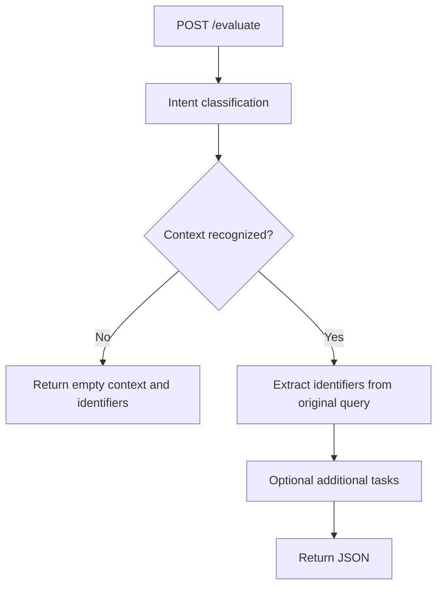

# FastAPI + LangGraph — PyTorch 2.2.1 / Python 3.10 edition

A new project implementing exactly two model tasks, using local PyTorch weights
in the `artifacts/` directory. No Qwen, Ollama, external LLM, learned tool policy,
repayment processing or database is needed.



This is a conditional LangGraph workflow. Its execution order is defined by
code, matching your requested two-task behavior.

## Run

This release targets your **Python 3.10 / PyTorch 2.2.1** environment.
The task implementations use compatible PyTorch APIs; the former >=2.6
requirement was an unnecessarily restrictive package pin, not a fundamental
requirement of the GRU models.

For your existing stock_pred Conda environment:

```bash
conda activate stock_pred
conda install "mkl=2024.0.0" "intel-openmp=2024.0.0" "numpy=1.26.4"
cd ~/python-workspace/query_pipeline
python -m pip install -r requirements.txt
python check_environment.py
python -m uvicorn app.main:app --host 127.0.0.1 --port 8000
```

The MKL adjustment repairs your reported native-library error. The Python
project cannot fix `iJIT_NotifyEvent` while `import torch` itself fails. Conda may
also adjust mkl-service, mkl_fft and mkl_random to resolve compatibility. Restart
running Python processes after modifying the environment.

The torch==2.2.1 pin accepts your existing CUDA-enabled 2.2.1 installation; do
not replace it with the CPU wheel just to run this project. The model loaders
still use CPU. NumPy is pinned below 2 for this older PyTorch baseline.

Alternatively, for a new Python 3.10 virtual environment with CPU-only PyTorch:

```bash
python3.10 -m venv .venv
source .venv/bin/activate
python -m pip install "torch==2.2.1" --index-url https://download.pytorch.org/whl/cpu
python -m pip install -r requirements.txt
python check_environment.py
python -m uvicorn app.main:app --host 127.0.0.1 --port 8000
```

API documentation: http://127.0.0.1:8000/docs
Health endpoint: http://127.0.0.1:8000/health

The model files are included; no training is needed to try the demo. Python
package installation requires downloads, but model inference runs locally with
no network access. No GPU is required. Compatible direct dependency versions are pinned in requirements.txt; test
dependencies are pinned in requirements-dev.txt. See COMPATIBILITY.md for validation details.

## HTTP request and response

```bash
curl -X POST http://127.0.0.1:8000/evaluate \
  -H 'Content-Type: application/json' \
  -d '{"query":"Create repayment request for employee ID 12345"}'
```

Recognized intent with a valid employee ID:

```json
{
  "context": "create_repayment",
  "identifiers": {"case_id": "", "employee_id": "12345", "sr_no": ""}
}
```

Recognized intent without a valid identifier:

```json
{"context": "create_repayment", "identifiers": {}}
```

Unknown, rejected or low-confidence intent:

```json
{"context": "", "identifiers": {}}
```

The extractor does not run in the last case. Extraction receives the original
query string, not the context string. Context remains in graph state and is
available to additional tasks.

A valid extraction returns all three identifier keys, with empty strings for
missing fields. If no identifiers are found, extraction is uncertain, or more
than one distinct ID of the same type is detected, the extractor returns `{}`.
Identifiers retain their exact text, including leading zeros. The supported
identifier format is one alphanumeric token containing at least one digit.
Punctuation-separated identifiers need a tokenizer/tagging extension.

A context match does not guarantee an identifier exists. Likewise, a valid ID
does not make an otherwise unsupported intent valid.

All these normal model outcomes return HTTP 200. Missing/blank/non-string queries
or unexpected request fields return HTTP 422. Runtime failures return HTTP 500;
model/deployment failures are not disguised as empty predictions.

## Artifact loading

Each subdirectory has its own predictor, model and training entry point:

| Path | Purpose |
|---|---|
| intent_classification/model.py | Sentence classifier model |
| intent_classification/predictor.py | Loads classifier artifacts; returns context or empty string |
| intent_classification/train.py | Train the classifier independently |
| intent_classification/prepare_data.py | Convert the earlier context/query_patterns format to JSONL |
| identifier_extraction/model.py | Token entity-tagging model |
| identifier_extraction/predictor.py | Loads extraction artifacts; returns ID JSON or `{}` |
| identifier_extraction/train.py | Train the extractor independently |
| artifacts/intent_classification/model.pt | Classifier weights |
| artifacts/intent_classification/metadata.json | Vocabulary, context labels and thresholds |
| artifacts/identifier_extraction/model.pt | Extractor weights |
| artifacts/identifier_extraction/metadata.json | Vocabulary, entity tags and threshold |
| app/main.py | FastAPI lifecycle, request/response schema, endpoints |
| app/graph.py | Conditional routing and task registration |
| app/extensions.py | Register additional graph tasks |
| common/ | Shared tokenizer, GRU encoder, artifact loading and training mechanics |
| evaluate.py | CLI evaluation using the same graph and loaders |

`artifacts` contains trained models and metadata, not incoming query strings.
The query arrives in the HTTP JSON body and is evaluated using those artifacts.

The default artifact directory resolves relative to this project's source path,
not the shell's current directory. To select a different artifact root:

```bash
export ARTIFACT_DIR=/absolute/path/to/artifacts
uvicorn app.main:app --host 127.0.0.1 --port 8000
```

The root must contain the same two task subdirectories. An application factory
also supports `create_app(artifact_dir=...)`. Models load once per server worker
at startup. Missing files, wrong task metadata or incompatible weights fail
startup. Restart workers after replacing a complete artifact bundle; hot reload
of model files is not implemented. CPU execution is default; set TORCH_NUM_THREADS
(default 2) to tune CPU thread usage for your deployment.

## Reuse of the code from this conversation

The included weights come from the most recent no-LLM project's trained
embedding + bidirectional GRU model. Its intent and entity heads have been split
into two independently loaded models, preserving their trained parameters and
vocabulary. The identifier head is not invoked by the classifier task.

The bundled classifier supports **create_repayment** plus a rejected
**unsupported** class. It is not the separate, older context_classifier.zip and
does not already know overpayment_details or letter_generation. Train with those
context labels to support them. Label names are loaded from metadata and are
not hard-coded into the graph or API.

The original synthetic training report is included for provenance. It concerns
the earlier shared model, not a fresh independent evaluation of this split
project. Those development examples were consulted during training improvements;
their high scores do not imply production accuracy. Confidence thresholds and
unknown-word rejection are heuristics, not guaranteed unknown-intent detection.

## Train either model

The demo data is included in data/train.jsonl and data/validation.jsonl.

```bash
python -m intent_classification.train --epochs 10
python -m identifier_extraction.train --epochs 10
```

Each command writes only its own artifact subdirectory, with model.pt,
metadata.json and validation_report.json. Train into a separate directory and
validate it before switching a running deployment's ARTIFACT_DIR.

Classifier training rows can use `intent` or `context`:

```json
{"query":"Show overpayment details for employee 12345","context":"overpayment_details"}
{"query":"Get the latest letter for employee 12345","context":"letter_generation"}
{"query":"What is the weather?","context":"unsupported"}
```

Include enough representative examples and negative/unsupported requests. Keep
paraphrase families separate between training and validation to avoid misleading
accuracy. The classifier requires unsupported examples. New context labels are
inferred from the training file, so no API/graph code change is necessary.

The older JSON structure can be converted:

```bash
python -m intent_classification.prepare_data intents.json data/classifier_all.jsonl
```

Input shape:

```json
{"intents":[{"context":"overpayment_details","query_patterns":["Show overpayment details for employee 12345"]}]}
```

This converter does not invent negative examples or split the data; add them and
create separate train/validation files before training:

```bash
python -m intent_classification.train \
  --data data/classifier_train.jsonl \
  --validation data/classifier_validation.jsonl \
  --output artifacts/intent_classification
```

Extractor rows require explicit character-span annotations. `end` is exclusive:

```json
{"query":"Create repayment for employee 12345","entities":[{"field":"employee_id","start":30,"end":35}]}
```

No-identifier rows use `"entities": []`. The accepted fields are employee_id,
case_id and sr_no. Each span must cover exactly one complete tokenizer token.
Do not use classifier context labels as entity annotations.

```bash
python -m identifier_extraction.train \
  --data data/extractor_train.jsonl \
  --validation data/extractor_validation.jsonl \
  --output artifacts/identifier_extraction
```

## Add more graph tasks

Define a function and register it in `app/extensions.py`:

```python
from .graph import ExtraTask


def get_employee_information(state):
    # Replace this return with your service call.
    return {"employee_id": state["identifiers"].get("employee_id", "")}


EXTRA_TASKS = [
    ExtraTask("get_employee_information", get_employee_information,
              require_identifiers=True),
]
```

Tasks run sequentially after extraction, in registration order. Unknown intent
skips extraction and all added tasks. With `require_identifiers=True`, that task
is skipped when the identifiers object is empty; other later tasks still follow
their own settings. It does not guarantee a particular key is present, so check
employee_id inside a task that specifically requires it.

Each function receives a copy of state containing query, context, identifiers
and earlier task results. It returns a JSON object. Its result is stored under
`state["results"][task_name]`, which is also added to the HTTP response. Core
context/identifier fields cannot be overwritten through extension results.
Exceptions abort the request with HTTP 500; there is no automatic retry of
additional tasks with side effects.

A runnable extension example is included:

```bash
uvicorn examples.extended_app:app --host 127.0.0.1 --port 8000
```

For custom branching among future tasks, edit build_graph in app/graph.py.

## Verification

```bash
pip install -r requirements-dev.txt
python -m pytest -q
python evaluate.py "Create repayment for case ID 9001"
```

Tests cover conditional short-circuiting, original-query propagation, empty JSON,
actual trained-model inference, leading zeros, ambiguous IDs, extension ordering,
concurrent request isolation, API validation and configurable artifact paths.
Every request starts with fresh state. There is no checkpoint or conversation
memory to mix unrelated queries. This local API has no authentication; add your
normal access controls before exposing it beyond localhost.
